# MONOLOG — Design Reference (`bymonolog.com`)

> A ground-truth design & motion specification reverse-engineered from the live site.
> Captured 2026-07-04 against the production build using real Google Chrome (Playwright-driven),
> at 1440 / 810 / 390px viewports plus scroll and interaction states. Values are read from
> **computed styles, the published CSS variables, and the site's own JS bundle** — not guessed.
> Anything inferred rather than directly observed is called out explicitly in **Tech Notes → Flags**.

---

## 1. Overview

**Studio.** MONOLOG is a brand + web-experience studio founded by Huy ("By Huy") Nguyen in 2022, based in **Hanoi, Vietnam and Melbourne, Australia**, working worldwide. It builds "change-making digital presences for founder-led brands" — brand strategy, visual identity, website strategy/design, Webflow development, and 3D. Slogan: **"Refuse to be underestimated."** Heavy award pedigree (Awwwards SOTD ×5, FWA, CSSDA) is used as social proof throughout.

**Aesthetic.** Editorial, near-monochrome, and cinematic. The palette is essentially a **duotone** — near-black `#080807` against warm off-white `#e8e8e3` — with greige mid-tones and a single muted olive accent. Type does the heavy lifting: an oversized grotesque display face (Animo) for statement moments, a neo-grotesque (KH Teka) for everything readable, and a mono (Suisse Mono) for labels/eyebrows. Surfaces are flat (almost no shadows), textures come from **film-grain / halftone dithering** generated in WebGL, and photography/video is desaturated.

**Core experience.** A single long-scroll homepage (~13,200px) that behaves like a controlled film reel. Smooth inertia scrolling (Lenis) glides between full-viewport "scenes"; each scene reveals via masked line-splits and translate/scale parallax driven by GSAP ScrollTrigger. The background is a living, gooey, pixel-dithered WebGL noise field. A **bespoke lerp-follow cursor**, **generative hover/click sound design** with looping ambient music, a **theme that inverts light↔dark per section**, and **Barba page transitions** complete a highly art-directed, "awwwards-tier" feel. The tone: confident, restrained, expensive.

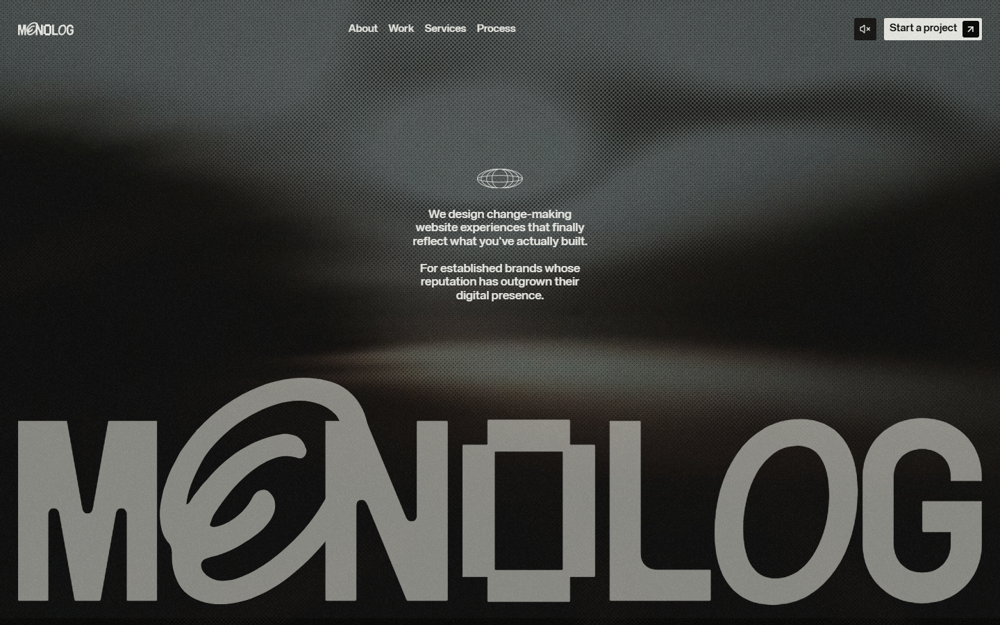
*Hero at rest, desktop 1440px: WebGL smoky field, wireframe globe, centered copy, bottom-anchored MONOLOG wordmark.*

---

## 2. Design Tokens

All tokens are the site's own CSS custom properties (Client-First / Webflow "fluid" system). Fluid values use `clamp()` mapping the viewport **320px → 1600px** (`--site--viewport-min: 20`rem → `--site--viewport-max: 100`rem). **Root font-size = 16px** (confirmed: `h5` token `1.375–1.5rem` computes to 23.75px at 1440, matching measured). Below, "min" = ≤320px, "max" = ≥1600px, and 1440 = measured value at desktop capture width.

### 2.1 Color palette (swatches)

| Token | Hex | Role |
|---|---|---|
| `--swatch--black-400` | `#080807` | **Primary background** (near-black), dark-theme surfaces, dark text on light |
| `--swatch--card-bg` | `#181715` | Dark card / raised panel |
| `--swatch--black-300` | `#393632` | Dark neutral (borders/hairlines on dark) |
| `--swatch--black-200` | `#524d47` | Muted (text-link hover border) |
| `--swatch--black-100` | `#6b645c` | Muted neutral |
| `--swatch--black-50` | `#938f8a` | **Muted / secondary text** (labels, captions on dark) |
| `--swatch--beige-100` | `#e8e8e3` | **Primary text** (off-white) = `--swatch--brand-text` |
| `--swatch--beige-100-2` | `#fafaf9` | Dark-theme text (brightest white) |
| `--swatch--beige-200` | `#ddddd5` | Light neutral (result-pill bg on light) |
| `--swatch--beige-300` | `#d1d1c7` | **Light-theme background**, pills, selection |
| `--swatch--beige-400` | `#bfbfb1` | **Button primary fill / theme border** |
| `--swatch--beige-600` | `#8c8c73` | **Olive accent** (heading-accent, background-2) |
| `--swatch--transparent` | `transparent` | — |
| — | `color-mix(brand-text 20%, transparent)` | `--swatch--brand-text-o20` (20% overlay) |

**Semantic (theme) mapping** — `--_theme---*` resolves per active theme:

| Theme | `background` | `text` | `border` |
|---|---|---|---|
| **Dark** (default, `.u-theme-dark` / `[data-theme-section="dark"]`) | `#080807` | `#fafaf9` | `beige-400` |
| **Light** (`.u-theme-light` / `[data-theme-section="light"]`) | `#d1d1c7` | `#080807` | `beige-400` |
| **Accent button** | `beige-400` | `brand-text` | self |

Text selection: background `beige-300`, text `black-400`.

### 2.2 Typefaces

| Family | Stack | Weights loaded | Usage |
|---|---|---|---|
| **KH Teka** | `Khteka, Arial, sans-serif` | Medium **500** only (`KHTeka-Medium.woff2`) | Primary — body, UI, most headings. (Note: only the 500 file is served, so `u-weight-bold` does **not** actually get heavier — everything renders at Medium.) |
| **Animo** | `Animo, Arial, sans-serif` | 400 / 500 (`Animo-Normal_Regular.woff2`) | Secondary **display** — oversized uppercase statements ("WE CLOSE THAT GAP", "SUCCESS STORIES", "LET'S BUILD…"). |
| **Suisse Mono** | `"Suisse Mono", Arial, sans-serif` | 400 / 500 (`SuisseIntlMono-Regular-WebXL.woff2`) | Tertiary **mono** — eyebrows, counters, meta labels ("(REAL CLIENT STORIES)", "EST 2022", "01/06"), uppercase. |
| webflow-icons | (embedded base64 TTF) | 400 | Webflow system glyphs only. |

Text-trim (leading-trim) tokens exist per family (`--font--primary-trim-top/bottom: .38em`, secondary `.33/.38em`, tertiary `.33/.38em`) — used to optically crop line-box whitespace on large type.

### 2.3 Type scale (fluid)

Base token values (min → max, in rem; ×16 for px). Utility classes `u-text-style-*` apply these. **Line-height** and **letter-spacing** columns are the token defaults.

| Style | Font | Size min→max (px) | @1440 | LH | Letter-spacing | Transform |
|---|---|---|---|---|---|---|
| `display` | Animo | 80 → 148 | ~139 | 0.90 | ~-0.03em | **uppercase** |
| `display-small` | Animo | 64 → 128 (maps 320→1440) | — | — | — | uppercase |
| `h1` | KH Teka | 80 → 96 | 94 | 1.0 | inherit | none |
| `h2` | KH Teka | 48 → 76 | ~72 | 1.0 | inherit | none |
| `h3` | KH Teka | 32 → 56 | ~53 | 1.0 | inherit | none |
| `h4` | KH Teka | 24 → 48 | 45 | 1.0–1.1 | -0.01em | none |
| `h5` | KH Teka | 22 → 24 | 23.75 | 1.1 | -0.015em (~-0.356px) | none |
| `h6` | KH Teka | 16 → 18 | ~17.6 | 1.0 | — | none |
| `text-large` | KH Teka | 18 → 20 | ~19.75 | 1.3 | — | none |
| `main` / `text-main` | KH Teka | 16 → 18 | 17.75 | 1.3 | -0.01em | none |
| `small` / `text-small` | KH Teka | 14 → 16 | ~15.75 | 1.3 | — | none |
| `xsmall` | KH Teka | 10.4 → 12 | ~11.8 | 1.0 | -0.01em | — |
| `text-micro` | KH Teka | 9.6 → 10.4 | ~10.2 | — | — | — |
| mono label (`large u-text-mono`) | Suisse Mono | (uses `text-large`) | 11.8 | 1.3 | -0.01em | **uppercase**, color `#938f8a` |

Line-height tokens: `0.90, 1.0, 1.1, 1.3, 1.5`. Letter-spacing tokens: `-0.01em, -0.015em, -0.03em`.

**Per-section overrides (important):** statement headings do **not** all use the base scale — several carry bespoke sizes:
- `.works_home_heading` ("SUCCESS STORIES") → `font-size: 13.85vw` (≈ **199px** @1440) — pure viewport-width scaling, edge-to-edge.
- `.problems_home_heading` (tagged `u-text-style-h1`) → overridden **down** to `h4` size (**45px**), `max-width: 23ch`, LH 1.1.
- `.gap_home_inner_heading` → `display` (**~139px** @1440), split into `.is-left` / `.is-right` halves.
- `.cta_home_heading` → `display`, LH 0.90, lines offset via `.is-2 {translateX 10%}`, `.is-3 {translateX -3%}`, `.is-4 {align-self:flex-end}`; `.is-arrow` swaps to KH Teka for the inline "→" glyph.
- `.services_home_heading` → `u-text-style-h2` **+ `mix-blend-mode: difference`** (renders ~94px; interacts with the image panel behind it).
- `.process_home_heading` → `display`, colored `--swatch--card-bg`.

### 2.4 Spacing system (fluid)

| Token | min → max (px) |
|---|---|
| `space--1` | 6 → 8 |
| `space--2` | 10 → 12 |
| `space--3` | 14 → 16 |
| `space--4` | 20 → 24 |
| `space--5` | 28 → 32 |
| `space--6` | 32 → 40 |
| `space--7` | 36 → 48 |
| `space--8` | 40 → 64 |

**Section spacing** (vertical rhythm):

| Token | min → max (px) | @1440 |
|---|---|---|
| `section-space--none` | 0 | 0 |
| `section-space--small` | 48 → 80 | ~76 |
| `section-space--main` | 64 → 112 | **106** (measured spacer height) |
| `section-space--large` | 88 → 160 | ~151 |
| `section-space--page-top` | 112 → 224 | ~210 |

### 2.5 Radii, borders, shadows

- **Radii:** `--radius--small: .15rem` (2.4px, result pills), `--radius--medium: .35rem` (5.6px), `--radius--main: 1rem` (16px, cards/media), `--radius--round: 100vw` (pills/round buttons). Utilities: `.u-radius-small/main/round/none/inherit`.
- **Borders:** hairline `1px` in theme border (`beige-400` on dark, or `black-*`); text-links use a `1px` bottom border that transitions on hover.
- **Shadows:** the design is essentially **shadowless / flat**. The only box-shadows are Webflow system defaults (form focus rings `0 0 0 2px #fff`, `0 0 0 1px #0000001a, 0 1px 3px #0000001a`) and a faint cursor glow (`0 0 3px #3336`). Depth is created by theme contrast and blur, not elevation.

### 2.6 Breakpoints

Standard Webflow tiers plus custom large tiers:

| Query | Purpose |
|---|---|
| `max-width: 479px` | Mobile portrait |
| `max-width: 767px` | Mobile landscape / large phone |
| `max-width: 991px` | Tablet |
| (base) 992–1439px | Desktop |
| `min-width: 1440px` | Large desktop |
| `min-width: 1920px` | XL desktop |
| `min-width: 768px` | (tablet-up utilities) |

Layout fluidity is primarily **continuous** (clamp/vw) rather than stepped; breakpoints mostly restructure grids and hide/show nav.

### 2.7 Motion tokens

**CSS easing variables:**
- `--animation-primary: cubic-bezier(0.83, 0, 0.17, 1)` — expo in-out (primary reveal/transition)
- `--animation-secondary: cubic-bezier(0.31, 0.75, 0.22, 1)`
- `--animation-expo-out: cubic-bezier(0.2, 1, 0.36, 1)`
- `--active-ease: cubic-bezier(0.48, 1.68, 0.64, 1)` — **overshoot / back** (active/toggle states)
- `--duration-fast: 0.45s`, `--active-speed: 0.35s`

**GSAP `CustomEase` (registered in JS):**
- `ease-primary` = `0.55, 0, 0.7, 0`
- `ease-secondary` = `0.31, 0.75, 0.22, 1`
- `ease-fade` = `0.76, 0, 0.24, 1`
- `ease-preloader` = `0.25, 1, 0.5, 1`
- `ease-transition` = `0.22, 1, 0.36, 1` (the workhorse for reveals/menu/Barba)
- `ease-menu` = `.7, 0, .22, 1`

**JS duration constants:** `fast: 0.3s`, `normal: 0.65s`, `slow: 1.075s`.

---

## 3. Layout & Grid

- **Global grid:** 12 columns. `--site--gutter: 1rem` (16px). `--site--column-count: 12`. Column width is fluid: `min(max-width, 100% − margin×2) − gutters` / 12. Helper tokens exist for `--column-width--1…12`, `--column-margin--1…12`, `--grid-1…12`, `--span-1…12`, and named grid lines (`--grid-breakout` for full-bleed↔content escape).
- **Content max-width:** `--max-width--main: 100rem` = **1600px**; content is centered, full-bleed elements break out to viewport edges.
- **Side margin:** `--site--margin: clamp(12px, …, 28px)` (**26px @1440**). Most sections apply this as left/right padding; the page never touches the edge except for intentional full-bleed media/type.
- **Page shell:** `body → .page_wrap (flex column) → header.navbar_wrap + main.page_main`. Fixed overlays live as top-level siblings: `.cursor_wrap` (custom cursor), `.about_wrap` (About drawer), `.menu_wrap` (mobile menu), `.g_overlay` (transition/veil), a fixed grain/position layer, and `.guide_wrap` (dev grid guide, hidden).
- **Section rhythm:** each home section is a full-width band, most ~1 viewport tall or taller, separated by `u-section-spacer` blocks (~106px @1440). Vertical air is generous; statement sections (gap, works, cta) run near-full-viewport with large negative-space margins around the type.
- **FAQ grid:** `.faq_home_wrap.u-grid-custom` is an explicit **12×101px grid, 16px gap** — content items span subsets of columns for an asymmetric editorial layout.
- **Common column spans in use:** gap cover image = `--column-width--3` (aspect 4/5); process/services media = `--column-width--6`; About drawer = fixed `720px` panel.

---

## 4. Components

### 4.1 Navbar (`.navbar_wrap`)
- **Anatomy:** fixed top bar (~84px tall, 26px side padding). Left: **MONOLOG** logotype (custom SVG wordmark, ~8rem max). Center: text links — About, Work, Services, Process (`.navbar_link`, KH Teka 500, **15.75px**, `-0.16px` LS; some show "(SOON)" state). Right: **sound toggle** (mute icon) + **"Start a project"** button.
- **States:** links have `[data-link-hover]` micro-interaction (see Motion). The whole bar is **theme-aware** via `[data-theme-nav]` — it inverts to dark-on-light when a light section (`data-theme-section="light"`, e.g. Works) scrolls under it, and back.
- **Mobile (`≤767`):** links collapse into a **"Menu"** toggle (`[data-menu-btn]`) that opens the full-screen `.menu_wrap` overlay; "Start a project" and sound toggle remain in the bar.

### 4.2 Buttons (`.g_btn_wrapper` / `[data-btn-default]`, 15 instances)
- **Primary:** fill `beige-400` (`#bfbfb1`), text = brand-text; **hover inverts** — `background → theme text`, `text → theme background` (token-driven `button-primary--*-hover`). Often paired with a small boxed **↗ arrow aside** (`.g_btn_aside_wrap`) that animates on hover.
- **Secondary:** transparent fill, `1px` theme border, text = theme text; hover fills with theme text, text becomes theme bg.
- **Examples:** "Start a project ↗" (nav), "Tell us your story ↗" (CTA, large light pill), footer/"Back to top ↑".
- **States:** default / hover (invert + arrow shift) / focus (Webflow ring) / active. Buttons carry `[data-cursor-hover]` and `[data-sound-hover]`.

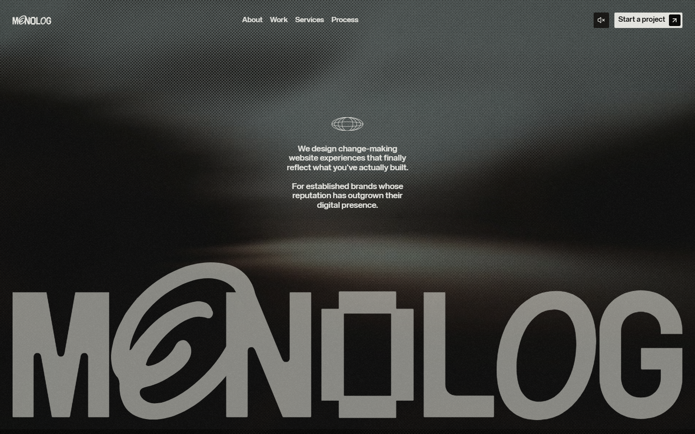
*Primary button under hover: fill/text invert plus the boxed arrow aside.*

### 4.3 Nav / list links (footer & menu)
- Large stacked links (Work, Process, Services, Resources, Contact) at `text` size ~17.75px, `15.75px` vertical padding, separated by **full-width hairline rules**, each with a `[data-footer-arrow]` "→" that slides in on hover. Color `#fcfcfc` on dark.

### 4.4 Work / result card (`.works_home_*`)
- **Anatomy:** large project media (image or muted autoplay video, ~16/10) on the left; right column = mono index counter ("SS ←01/06"), project **title** (`h5`, 23.75px), muted description, and a **result pill** — `.works_home_result_value` = value like "$2M+" / "58%" in a `beige-200/300` pill, `2.4px` radius, `7.75px` vertical padding, dark text.
- **States:** hover triggers cursor label + sound; media may parallax within its frame.

### 4.5 Services list (`.services_home_heading`, blend)
- Vertical stack of service names (Brand Strategy, Visual Identity, Website Strategy, Website Design, Website Development, 3D Development). Active item is full-brightness; others dimmed. `mix-blend-mode: difference` makes the type invert against the **content-swap image panel** (`[data-content-image]`, 6) on the right, which changes per active `[data-content-trigger]`.

### 4.6 Accordion (Process & FAQ, `[data-accordion-*]`, 7 toggles)
- CSS-initialised accordion (`data-accordion-css-init`) with `data-accordion-close-siblings` (single-open). Each row: index/label, heading, expandable body + (Process) an associated media panel. Toggle state via `data-accordion-status` + `data-accordion-toggle`; opens with the overshoot `--active-ease`.

### 4.7 Testimonial / content slider (`[data-slider]`, 2)
- Prev/next (`[data-slider-prev/next]`), a **counter** (`[data-counter-value]` current, `[data-dynamic-value]` = index+1), and a **progress bar** (`[data-progress-bar-start/end]`). Slides hold quote (`blockquote`, h5), author + headshot (`[data-slider-headshot]`), details. Used in Services (client stories) and the CTA testimonial.

### 4.8 About drawer (`.about_wrap` / `.about_modal_wrap`)
- **Anatomy:** a **720px right-side panel** that slides in over the page; the page behind is **dimmed + blurred** (backdrop veil). Header: "About the studio" (dot bullet) + **"Close ESC"** button. Body: founder story (KH Teka), a mono meta row ("EST 2022" / "BASED IN MELBOURNE AND HANOI"), an embedded **video** (`.about_modal_video_wrap`, "listen"), then **Clients** (Vinamilk, Moc Chau Creamery, OH Architecture, Supersolid, Mammoth Murals, SLIK, BlueBrown, Backhouse, University of Sydney), **Awards**, and **Our principles** (Outcomes first, taste second · All in or nothing · Human-first, always · Intention over speed).
- **Behavior:** opens via `[data-open-modal]` (About), `data-about-status="is-open"`, sets `data-lenis-prevent` + `overflow-hidden` on body, and runs its **own Lenis instance** for internal scroll. Closes on Close button, backdrop, or **ESC**.

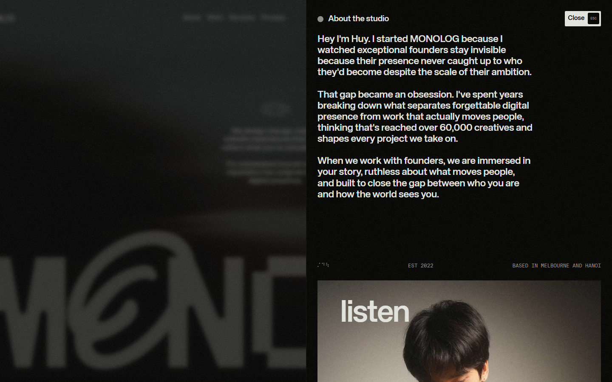
*720px right-side panel over a dimmed/blurred backdrop; founder story, mono meta row, embedded video.*

### 4.9 Custom cursor (`.cursor_wrap` / `[data-cursor]`)
- Small element that **lerp-follows** the pointer; morphs to `active` / `active-edge` over interactive targets and can display a **contextual text label** (see Motion 5.6). Faint glow shadow. Replaces/augments the native cursor.

### 4.10 Sound toggle (`.navbar_left_sound_*`)
- Mute/unmute control persisting to `localStorage` (`monolog_sound_enabled`); governs hover SFX + ambient BGM. Icon reflects on/off.

### 4.11 Footer (`.footer_wrap_main`)
- Left: large nav link column with hairlines + hover arrows. Right: location blurb ("Based in Hanoi City, Vietnam and Melbourne, Australia. Working Worldwide."), Instagram ↗, and an **"(ASK AI ABOUT MONOLOG)"** row of AI-platform icons. Bottom meta row: **live clock** ("Hanoi City 02:55:45 PM / Saturday, Jul 4, 2026 (GMT +07)"), "Back to top ↑", "Booking projects for Q3 '2026", "©2026 MONOLOG Studio". A giant **MONOLOG** wordmark and the **"『Refuse to be underestimated.』"** slogan sit over a **halftone-dithered wave** graphic (`[data-footer-parallax-dark]`). The clock/date/year are live JS (`[data-footer-time/date/year]`).

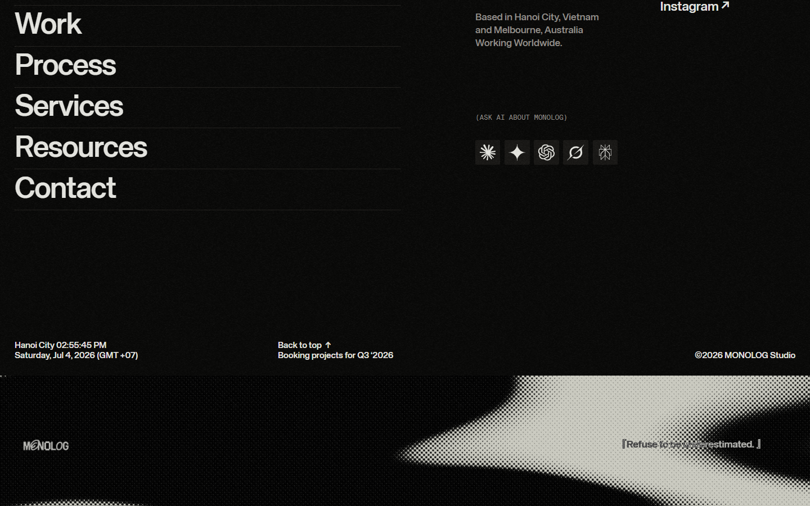
*Nav column, location/AI-platform row, live clock meta line, and the halftone-wave wordmark treatment.*

---

## 5. Motion & Interaction

Stack: **GSAP 3.15.0** (+ ScrollTrigger, SplitText, CustomEase) is the animation core; **Lenis 1.x** provides smooth scroll; **three.js r160** renders the background field; **Barba 2** handles page transitions; **Howler 2.2.4** handles sound. Lenis and ScrollTrigger are unified through GSAP's ticker.

### 5.1 Smooth scroll (Lenis)
- Instantiated as `new Lenis({ duration: 0.5, orientation: 'vertical' })`.
- Driven by GSAP ticker: `gsap.ticker.add(t => lenis.raf(t*1000))`, `gsap.ticker.lagSmoothing(0)`; `lenis.on('scroll', ScrollTrigger.update)` keeps triggers in lock-step.
- On load it **force-scrolls to top** (interval loop for ~1s + `scrollTo(0,{immediate,force})`) so refreshes always start at the hero.
- In-page anchors (`a[href^="#"]`) are hijacked to `lenis.scrollTo(target)`; the "#to-top" control uses `duration: 1`. A **second Lenis** (ticker `raf(t*1500)`) powers the About drawer's internal scroll. Body gets `data-lenis-prevent` + `overflow-hidden` while overlays are open.
- **Feel:** short duration (0.5) = quick, tightly-damped glide — responsive rather than floaty, but enough inertia to smooth scrubbed parallax.

### 5.2 Scroll reveals (SplitText line-mask) — `[data-split-reveal]`, `[data-split-text]` (7)
- Text is split with `SplitText.create(el, { type, mask: 'lines', linesClass })`. Granularity from `data-split-reveal`: `lines` (default), `words`, or `chars`.
- Reveal timeline: lines start `yPercent: 150, opacity: 0` (some variants `yPercent: 100`) and animate to `yPercent: 0, opacity: 1` with **stagger** and `ease: 'ease-transition'` (`0.22,1,0.36,1`), `immediateRender: false`. Because lines are `mask:'lines'`, they wipe up from behind a clip edge.
- **Trigger:** ScrollTrigger on enter (typical `start: "top bottom"` → `top 80%`); most reveals are **play-once** (not scrubbed).

### 5.3 Parallax & translate — `[data-translate-hero]` / `[data-target-translate]` (7), `[data-overlay-scroll]`
- Elements declare a translate magnitude (e.g. `data-target-translate="100"`) and are moved on a **scrubbed** ScrollTrigger (`scrub: true`, `ease: 'linear'`).
- **Hero:** content/overlay translate up as you leave (`data-translate-hero`, `data-overlay-container`), the WebGL canvas holds behind.
- **Gap section:** the two display halves (`.is-left` "WE CLOSE", `.is-right` "THAT GAP") translate apart on scroll to open a slot for the centered 4/5 product image — a literal visual pun on "closing the gap".
- **Footer:** `[data-footer-parallax]` inner layers move at offset rates (`yPercent: -15` and `-80`, linear, scrubbed) for depth; the dark halftone graphic parallaxes independently.
- Common ScrollTrigger ranges observed: `start:"top bottom"` / `end:"bottom top"` (full-travel scrub), plus `clamp(top bottom)`/`clamp(top top)` guards and `top 50%`, `top 65%`, `top 80%` play-triggers.

### 5.4 Stacking cards — `[data-stacking-cards-item]` (2)
- The Problems and Gap scenes behave as stacked panels: as the next scene scrolls in, the current one **scales to ~0.95, shifts `yPercent`, and fades `autoAlpha`** (durations from the `fast/normal/slow` set), so scenes overlap and recede rather than simply scrolling away. Pinning + scrub give the "cards on a stack" feel.

### 5.5 WebGL background field — `[data-hero-canvas]`, `[data-canvas]` (three.js r160)
- **Setup:** `OrthographicCamera(-1,1,1,-1,0,1)` + `PlaneGeometry(2,2)` full-screen quad, `WebGLRenderer`, **two `ShaderMaterial` passes** (a field/noise pass rendered to a render-target, then a composite pass with `transparent` support).
- **Config object (hero):** `amplitude 0.8, timeSpeed 0.0045, holdAmplitudeMultiplier 2, holdTimeSpeedMultiplier 1.5, lerpSpeed 0.03, autoReveal true, revealDuration 2, revealDelay 0.3, revealEase 'ease-secondary', pixelSize 4, gooeyness 0.58, contrast 1.5, bias 0, invert 1, bg '#E8E8E3', fg '#080807', transparentBg 0, waveFrequency 1, waveAmplitude 0, waveTimeSpeed 0, maxDpr 1, targetFrameMs 1000/60, interactive true`.
- **Behavior:** a `uReveal` uniform tweens **0→1 over ~2s** (with 0.3s delay, `ease-secondary`) as an **intro/preloader** wipe. Each frame, `currentAmplitude`/`currentTimeSpeed` **lerp** (rate 0.03) toward targets and feed `uAmplitude`/`uTime`, producing a slowly flowing, smoky gradient. On interaction ("hold"), amplitude ×2 and time-speed ×1.5 make the field surge. `pixelSize 4` + `gooeyness 0.58` + high `contrast` yield the signature **chunky halftone/dithered, metaball-like texture**; `maxDpr 1` caps cost.
- Result: the grain/dither you see across dark sections is generated, not an image overlay.

### 5.6 Custom cursor — `[data-cursor]` + `[data-cursor-text-target]`
- Position is smoothed with `gsap.quickTo(el, 'x')` / `quickTo(el, 'y')` (lerp), updated in a `requestAnimationFrame` loop from the pointer coords.
- Each frame it runs `document.elementFromPoint(x,y).closest('[data-cursor-hover]')` (4 targets). If over one, `data-cursor` → `"active"` (or `"active-edge"` when near the right viewport edge, so the label flips inward). If the target has `data-cursor-text`, that string is written into `[data-cursor-text-target]` (e.g. a "View" / drag hint label). Otherwise state clears.

### 5.7 Hover micro-interactions
- `[data-hover-heading]` (24) & `[data-hover-highlight]` (23): link/heading hovers that shift color/underline or reveal an accent highlight.
- `[data-link-hover]` (4): nav-link hover (e.g. label swap/slide).
- `[data-footer-arrow]` (11): "→" arrow translates in on footer/menu link hover.
- Buttons: fill/text **invert** on hover (token `button-*--*-hover`) with the boxed arrow nudging.
- All interactive elements also fire hover **sound** (`[data-sound-hover]`) and drive the cursor state.
- Timing for these small states typically uses `--active-speed 0.35s` / `--duration-fast 0.45s` with `--active-ease` (overshoot) or `ease-transition`.

### 5.8 Theme inversion on scroll — `[data-theme-section]` (5) → `[data-theme-nav]`
- Each section declares `data-theme-section="dark|light"`. As it crosses under the navbar (ScrollTrigger, ~`top 50%`), the site swaps the active `--_theme---*` set and updates `[data-theme-nav]`, so the fixed navbar's logo/links/icons **invert** to stay legible (dark-on-light over the Works section, light-on-dark elsewhere). Section background/text transition together.

### 5.9 Counters / indices
- The visible "01/06", "02/02", "03/03" figures are **slider position indices**, set imperatively (`textContent = index`) as slides change — not rolling-odometer number tweens. Result values ("$2M+", "58%") are static content, not counted up. (No numeric count-up tween was found in the bundle.)

### 5.10 Menu open/close (mobile) — `.menu_wrap`, `[data-menu-btn]`
- GSAP timeline: overlay in, links stagger from `yPercent: 20/‑100, autoAlpha 0 → 0` with `scale 0.95 → 1`, durations `fast/normal/slow`, `ease` ≈ `ease-menu`/`ease-transition`. Close reverses (`yPercent: -100, scale 0.95, autoAlpha 0`). Body scroll locked via `data-lenis-prevent`.

### 5.11 Page transitions (Barba)
- `data-barba="wrapper"` / `"container"` with a `data-barba-namespace`. Navigation runs a leave/enter through the `.g_overlay` veil using `ease-transition`; Lenis is destroyed/re-created and scroll reset to top per page. (Exact leave/enter durations not fully traced — see Flags.)

### 5.12 Sound design (Howler)
- Assets from `https://byhuy.b-cdn.net/soundlib-main`. **Hover taps:** `tap_01…05.mp3` (volume **0.15**), one chosen at **random** per hover event (`hover1…5`). **Click:** `select.mp3`. **Ambient:** `bgm.mp3` (loop, `volume 0.095`, `html5`, `preload/autoplay false`, lazy-loaded on enable), fading in/out over **600ms**. Master state persists in `localStorage['monolog_sound_enabled']`; a suspended `AudioContext` is resumed on first interaction. The nav toggle mutes/unmutes everything.

### 5.13 Preloader / intro
- The WebGL `uReveal` wipe (5.5) is the visible entrance; alongside it hero content reveals via SplitText (5.2), timed with `ease-preloader` (`0.25,1,0.5,1`). Combined effect: field materialises, wordmark + copy rise into place.

---

## 6. Media

- **Sources:** images served from Webflow CDN as **AVIF/WebP** (e.g. founder portrait `…_DSCF2544 copy.avif`); **8× `[data-video]`** elements — muted, autoplay, loop project/process/CTA footage (desaturated, cinematic B&W or muted color grade).
- **Aspect ratios:** gap product cover **4:5** (`--column-width--3`); work media ≈ **16:10**; process/services panels ≈ half-column landscape; CTA/hero run **full-bleed**.
- **Framing:** media sits in `--radius--main` (16px) rounded frames for cards, or edge-to-edge for scenes. The founder photo and CTA use full-viewport background media with type overlaid.
- **Reveal treatment:** media enters with scale/clip + parallax (5.3–5.4); text over media uses SplitText line-masks and, on Services, `mix-blend-mode: difference`.
- **Texture:** the pervasive grain/halftone is the **WebGL field** (5.5) plus a fixed grain layer; the footer wave is a **dithered/halftone** monochrome graphic. Overall look = matte, printed-poster texture rather than glossy.

---

## 7. Section-by-Section Walkthrough (top → bottom)

1. **Navbar** (fixed, dark). Logo · About/Work/Services/Process · sound toggle · "Start a project ↗". Theme-inverts as sections pass.
2. **Hero** (`.hero_home_wrap`, dark). Full-viewport **WebGL smoky field** (reveals over ~2s), a small **wireframe globe** icon, centered copy — "We design change-making website experiences that finally reflect what you've actually built. For established brands whose reputation has outgrown their digital presence." — and a giant **MONOLOG** logotype anchored to the bottom. Content parallaxes up on scroll. *(see hero screenshot in §1 Overview)*
3. **Problems** (`.problems_home_wrap`, dark; stacking + slider). Left: **"30+ / Globally recognized awards (Awwwards, FWA, CSSDA)"** stat with a "02/02" index. Right: large statement (KH Teka, h4/45px) — "Great founders changing the world deserve a presence as powerful as what they're building…" — with founder attribution (Huy + headshot). Bottom: **"Brands we worked with"** logo strip (Vinamilk, Moc Chau, Univ. of Sydney, OH…). Panel scales/recedes as the next enters.

   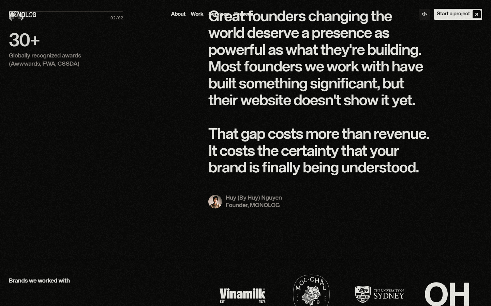

4. **Gap** (`.gap_home_wrap`, dark; stacking). Oversized Animo display split **"WE CLOSE … THAT GAP"**; the halves translate apart on scroll to reveal a centered **4:5 product image** in the slot. Supporting paragraph below: "Your website is where ideal customers decide if you're worth their time…".

   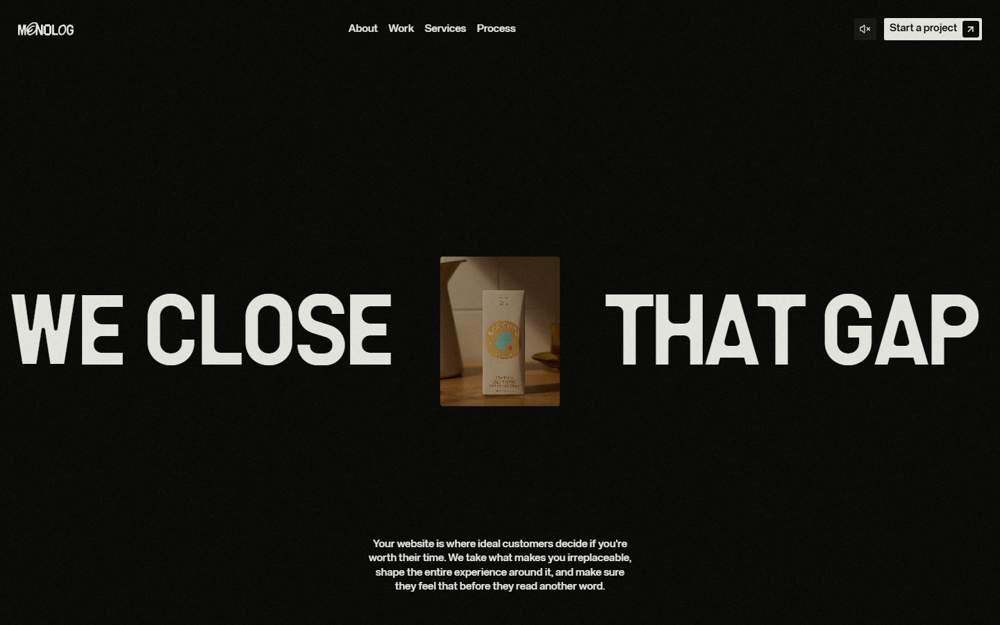

5. **Works — Success Stories** (`.works_home_wrap`, **light theme**, `#work`). Nav inverts to dark. Left label "Success Stories" (● bullet). Stacked case studies (OH Architecture, Supersolid, Mammoth Murals, HISS/Univ. Sydney, SLIK): big media + title + description + **result pill** ($2M+, 58%, $100K+, 15+…) + mono index ("SS ←01/06"). "SUCCESS STORIES" also renders as a **199px (13.85vw)** display band.

   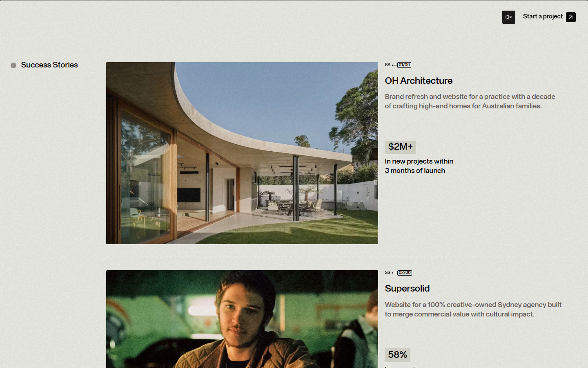

6. **Services** (`.services_home_wrap`, dark, `#services`; slider). Center: "What we can help with" + vertical **service list** with active-item highlight and `mix-blend-mode: difference` over a **content-swap image** (Ambitious/Intentional/Honest/…). Left: **client testimonial slider** ("(REAL CLIENT STORIES)", quote, author + headshot, ← → , "03/03", progress bar).

   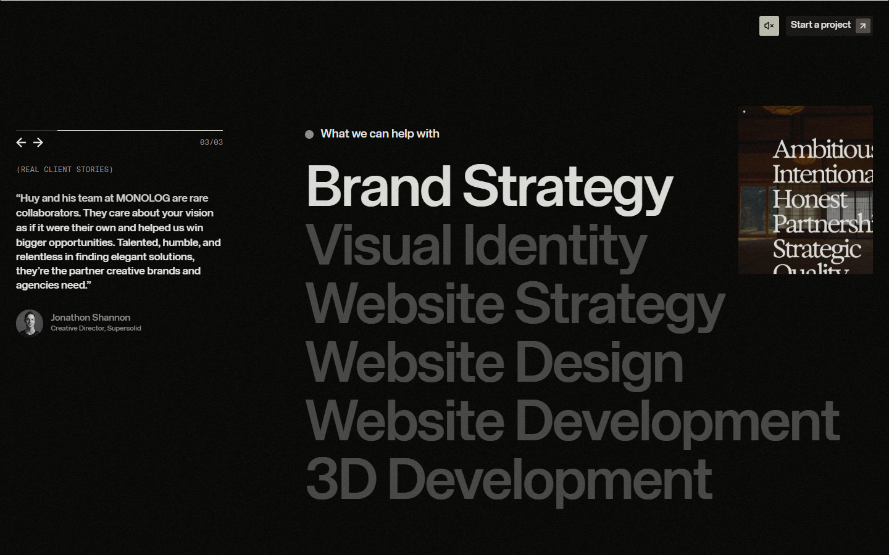

7. **Process — Project Journey** (`.process_home_wrap`, `#process`). Huge Animo **"PROJECT JOURNEY"**. Accordion of steps ("STEP • 01 We uncover your story", "02 We shape your digital presence"…) each pairing copy with a **video panel** (e.g. handwritten "Make it cool → A memorable website").

   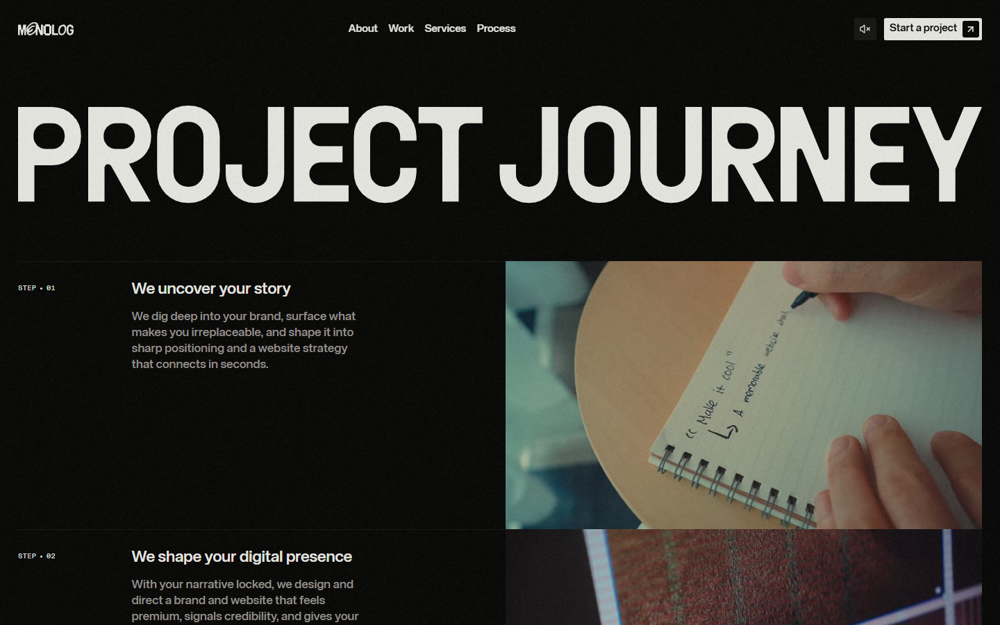

8. **FAQ** (`.faq_home_wrap.u-grid-custom`, `#faqs`). 12×101px editorial grid; accordion of pre-engagement questions ("Here's what you need to consider before partnering with us.").

   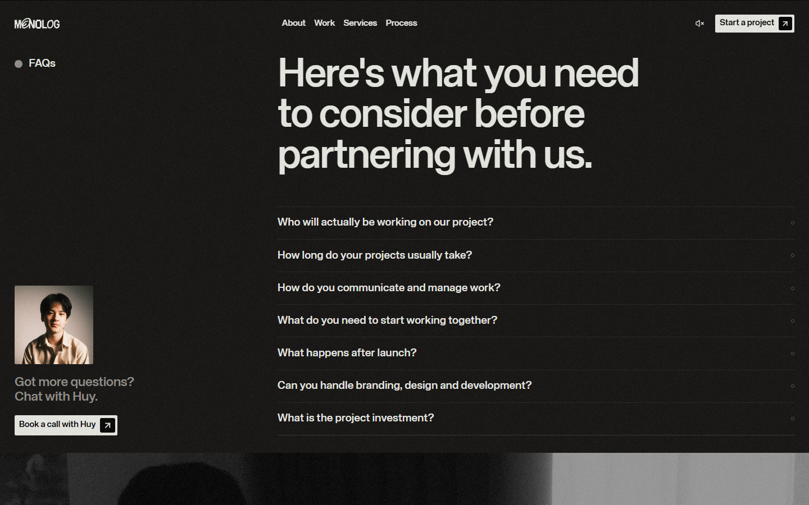

9. **CTA** (`.cta_home_wrap`). Full-bleed desaturated founder-at-desk media; giant Animo **"LET'S BUILD / AN EXPERIENCE / THAT MOVES / → PEOPLE"** with per-line offset transforms and an inline arrow; large light **"Tell us your story ↗"** button.

   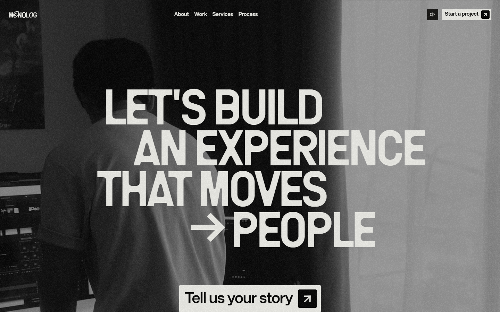

10. **Footer** (`.footer_wrap_main`). Nav column (Work/Process/Services/Resources/Contact) with hairlines + hover arrows; location + Instagram; **"(ASK AI ABOUT MONOLOG)"** icon row; **live Hanoi clock/date**; "Back to top ↑"; "Booking projects for Q3 '2026"; "©2026 MONOLOG Studio"; giant MONOLOG wordmark + **"『Refuse to be underestimated.』"** over a halftone wave (parallax). *(see footer screenshot in §4.11)*
- **Overlays:** About drawer (720px, story/video/clients/awards/principles, own Lenis, ESC-close — see §4.8); mobile full-screen menu (stacked links + news card, shown below); custom cursor; transition veil.

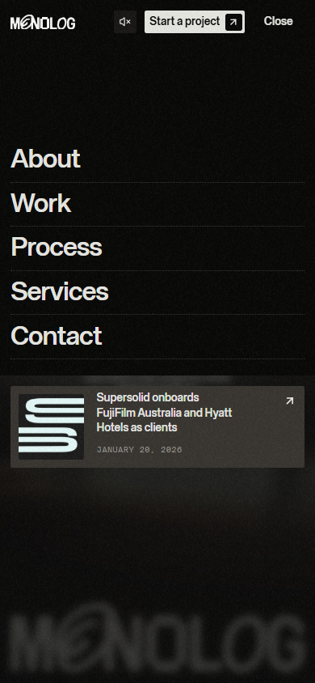
*Full-screen mobile menu overlay: stacked nav links, embedded news card, wordmark watermark.*

### Responsive comparison (hero, all three breakpoints)

| Desktop (1440px) | Tablet (810px) | Mobile (390px) |
|---|---|---|
|  | 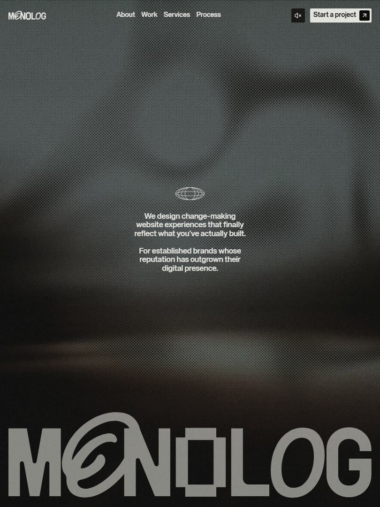 | 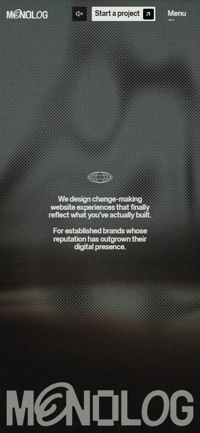 |

---

## 8. Tech Notes

**Inferred / confirmed stack**
- **Webflow** (CMS/build) — jQuery 3.5.1 + `webflow.*.js`; Client-First-style utility classes (`u-*`), fluid `clamp()` token system, `w-variant-*` component variants. Native Webflow IX2 is largely **not** the animation driver here — the custom bundle is.
- **GSAP 3.15.0** + **ScrollTrigger** + **SplitText** + **CustomEase** — all reveals, parallax, pin/stack, menu, cursor, counters.
- **Lenis 1.x** — smooth scroll, GSAP-ticker integrated.
- **three.js r160** — background shader field(s).
- **Barba 2** — SPA page transitions.
- **Howler 2.2.4** — sound (SFX + BGM), assets on `byhuy.b-cdn.net`.
- **Custom code host:** `cdn.odyn.dev/p/3pc9/bundle.js` (~38KB, minified) contains all bespoke orchestration (eases, Lenis, cursor, sound, WebGL config, sliders, accordions, theme switching). Loaded via a small inline loader; staging vs prod switched by host.
- Analytics: Google Tag Manager (`G-NZ1SEFWY0E`). SEO: JSON-LD `Organization` schema (founder, addresses, awards, reviews) embedded inline.

**Flags — observed but not fully reconstructable (do not treat as exact):**
1. **Fragment-shader math.** Uniforms and the full config object are captured verbatim (5.5), but the GLSL noise/gooey/dither functions themselves were not decompiled into reusable formulas — a faithful rebuild needs its own noise field tuned to those parameters.
2. **Barba transition timings.** Presence and mechanism (overlay veil + `ease-transition`, Lenis teardown) are confirmed; precise leave/enter durations/offsets were not isolated from the minified bundle.
3. **Services heading size (~94px).** It measures larger than the `h2` token max (76px); the override adds blend/z-index/position but the exact enlarging rule wasn't pinned down — verify against a live rebuild.
4. **`beige-600` / heading-accent.** The variable carries a Webflow "deleted variable" marker in the CSS (`#8c8c73` / also seen as `#8c8c73`); treat the olive accent hex as approximate and confirm usage context.
5. **Modal link "shimmer."** A subtle animated highlight on some About-copy words (likely `[data-highlight-text]`) was visible but its exact keyframes weren't traced.
6. **Minification caveat.** Timeline specifics (durations/staggers) are read from string literals and property names in a minified bundle; property *values* are reliable, but the precise sequencing of some composite timelines is reconstructed from evidence, not line-by-line source.

**Environment note.** The Playwright **MCP** on this machine is pinned to Chrome's per-user install path and failed to launch; captures were taken by driving the system Google Chrome (`C:\Program Files\Google\Chrome\Application\chrome.exe`) with Playwright directly — identical rendering. Reference screenshots (desktop/tablet/mobile per section + about-modal / mobile-menu / button-hover states) were saved to the capture scratchpad and were used to verify every claim above.
